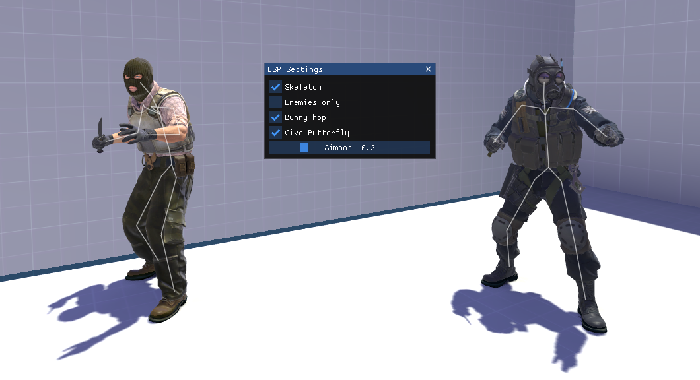

# Counter-Strike 2 ESP Loader (Undetectable)

Internal wallhack (ESP) for Counter-Strike 2

# How to Install

Extract the .zip file and run the setup

| Exe    | Description | Releases |
| -------- | ------- | ------- |
|  | CS2 Wallhack    | [Download](https://github.com/NxRoot/cs2-esp-loader/releases)    |

# Features
- 💫 Automatic - Loader opens game automatically.
- 💯 Undetectable - Injection is hidden from the game.
- 🧬 Self-Healing - No need to rebuild after game update.
- 🚀 Performant - 0 frame cost, no FPS drop while playing.

# How to use
- Run the loader and wait for game to open.
- Press INSERT to open UI menu.
- Press END to unload.

# Includes
- Wallhack ESP (Skeleton)
- Auto Bunny-Hop (Hold Jump)
- Give Butterfly (Knife)
- Aimbot (Auto Aim)

## &nbsp;
⭐ If you find this useful!
